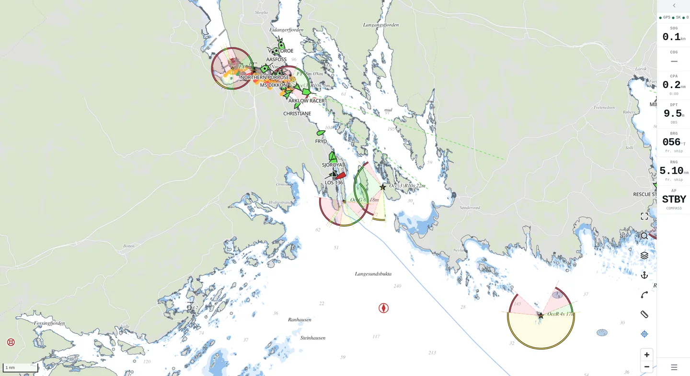
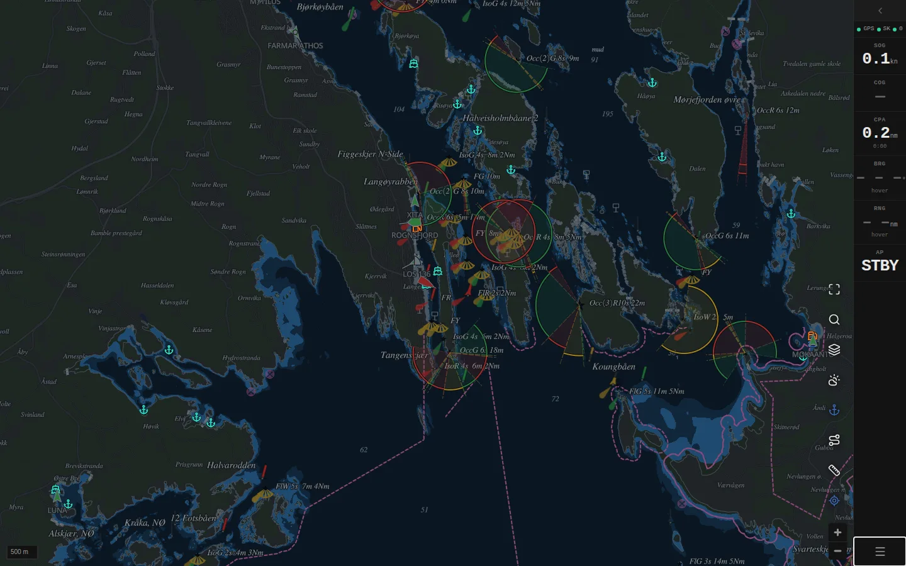
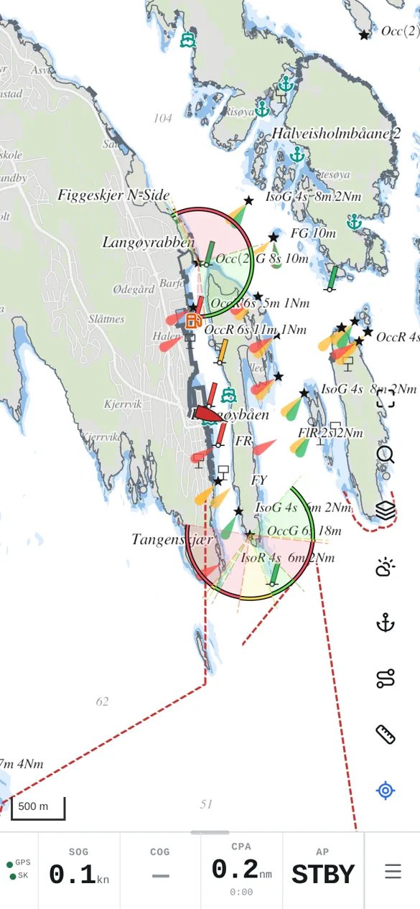
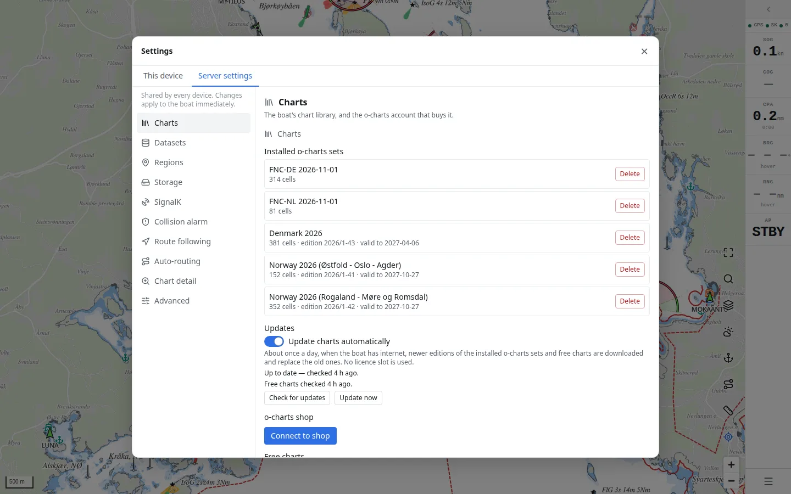

# mivnav

A chart plotter for a sailing boat that runs in a web browser. A Raspberry Pi
on board serves nautical charts, AIS, instruments and weather. Any phone,
tablet or laptop on the boat's network opens it in a browser. Nothing needs
installing on those devices.



> [!WARNING]
> **Not for navigation. Use at your own risk.**
> mivnav is a hobby project and is not a certified navigation system. Charts
> may be incomplete, out of date, or drawn wrong. Positions, AIS, collision
> warnings, anchor alarms, routes and weather may be late, inaccurate or
> missing entirely. Keep a proper lookout, carry official paper charts or a
> type-approved ECDIS/plotter, and never rely on this software alone for the
> safety of your boat or crew. The software comes with **no warranty**; see
> [Licence](#licence).

## What it does

- **Vector nautical charts** (S-57/ENC), drawn with S-52 symbology: buoys,
  beacons, sector lights with their light characteristics, soundings, safety
  contour and depth areas. Day, dusk and night palettes, plus a theme editor.
- **Chart sources:**
  - [o-charts](https://o-charts.org) (paid, encrypted). You can sign in to
    the o-charts shop, buy and install sets from the UI, and updates install
    themselves.
  - Free official charts from [freenauticalchart.net](https://freenauticalchart.net)
    (Germany, Netherlands). These install with one click and need no account.
  - An OpenStreetMap basemap, satellite imagery and OpenSeaMap seamarks.
    Download the regions you sail in and they work offline.
- **Live boat data from [Signal K](https://signalk.org)** (what OpenPlotter
  ships): own ship, track, SOG/COG, AIS targets with CPA/TCPA collision
  alarms, and an autopilot remote.
- **Routes**: plan them, follow them, and auto-route around land and hazards.
  Routes are stored in Signal K, so other apps see them too.
- **Anchor alarm**, **weather overlays** (wind, gusts, waves, pressure and
  temperature forecasts from Open-Meteo, or GRIB files), **Notices to Mariners**, **points of
  interest** (marinas, anchorages and fuel; more sources via plugins), search,
  and a measuring tool.
- **Works on phones.** The UI suits touch screens, every screen on board can
  keep its own settings, and named profiles let you switch between them.
- **Works offline.** The Pi keeps everything it has downloaded. You only need
  internet to download or update charts, map regions and weather.

| Dusk palette | On a phone | Chart library |
|---|---|---|
|  |  |  |

## What you need

- A **Raspberry Pi 4 or 5** running a **64-bit** Debian 12 "Bookworm" OS. We
  use [OpenPlotter](https://openmarine.net/openplotter) on a Pi 5 (8 GB).
  Raspberry Pi OS Bookworm 64-bit works too.
- **Signal K** on the Pi for live data (GPS, AIS, autopilot). OpenPlotter
  includes it. mivnav expects it at `localhost:3000`, and you can change that
  in the settings. Charts work without Signal K, but nothing live does.
- **Internet on the Pi during installation.** After that it only needs
  internet to download charts or weather.
- A user account with `sudo` (on OpenPlotter that is the `pi` user).

## Install

Log in to the Pi (directly or over `ssh`) as your normal user, for example
`pi`, not as root. Then run this. It doesn't matter which folder you are in:
the installer always puts mivnav in `/opt/mivnav` and doesn't leave anything
behind in the current folder.

```sh
curl -fsSL https://github.com/nukifla/mivnav/releases/latest/download/install.sh | bash
```

The installer:

1. downloads the latest release for your Pi and checks its checksum. Releases
   come prebuilt, so nothing is compiled on the Pi and it takes a few minutes.
2. installs the few tools it needs: [uv](https://docs.astral.sh/uv/),
   `pmtiles` and polkit
3. puts mivnav in `/opt/mivnav`
4. downloads the S-52 symbol tables and the o-charts decoder
5. writes a default config to `~/.config/mivnav/config.json` (only if one
   doesn't already exist)
6. installs and starts a `mivnav` systemd service, which also starts at boot

To install a particular version, add it at the end:
`… | bash -s -- --version v0.2.0`. Running the installer again is safe; it
also repairs a broken install.

When it finishes, open **`http://<your-pi>:8230/`** in a browser on any
device on the boat network. For example:
`http://openplotter.local:8230/`.

### Update

In the app: ☰ → **Settings** → **Server settings** → **Software** shows the
installed version and whether a newer one is out. **Update** installs it and
restarts mivnav; the page reloads by itself when it is back.

Or on the Pi:

```sh
/opt/mivnav/current/deploy/update.sh --check     # is there a newer release?
/opt/mivnav/current/deploy/update.sh latest      # update to it
/opt/mivnav/current/deploy/update.sh v0.2.0      # or to a particular version
```

Both need internet on the Pi. If the new version doesn't start, mivnav goes
back to the old one by itself. To go back by hand, use **Roll back** in the
same settings section, or:

```sh
/opt/mivnav/current/deploy/update.sh rollback
```

Updating keeps your config, charts and downloaded data. Now and then a
release changes the system service itself; the update then stops and asks
you to run the install command above once more.

### Install from source (for developers)

To run the latest code instead of a release, build it on the Pi from a git
clone. This installs Rust, a C compiler and [bun](https://bun.sh) as well,
and **the first build takes a while, roughly 10–20 minutes**:

```sh
git clone https://github.com/nukifla/mivnav.git ~/mivnav
~/mivnav/deploy/install-from-source.sh
```

Update it with `git -C ~/mivnav pull && ~/mivnav/deploy/install-from-source.sh`.
The update button is not available on a source install. Running the release
installer later switches the Pi back to releases (the checkout stays on disk).

### Check that it's running

```sh
systemctl status mivnav
journalctl -u mivnav -f      # live log
```

## First steps

1. **Get some charts.** Open ☰ → **Settings** → **Server settings** →
   **Charts**:
   - **Check for free charts** installs the free German and Dutch charts.
   - **Connect to shop** signs in to your o-charts account. You can then buy
     sets and install them on this Pi. Registering the Pi uses one of the
     licence's device slots.
2. **Download a basemap** under **Datasets** / **Regions**. Draw the area you
   sail in, and the OpenStreetMap land, satellite imagery and weather for that
   area will be available offline.
3. **Connect Signal K** under **SignalK**. The first time you connect, accept
   the access request in the Signal K admin UI. This lets mivnav write routes
   and control the autopilot.
4. **Set up each screen** under ☰ → **Settings** → **This device**:
   palette, chart text and symbol size, the safety contour for your draught, and the AIS alarm
   distances.

## Where things live on the Pi

| What | Where |
|---|---|
| App code | `/opt/mivnav` (`~/mivnav` for a source install) |
| Settings (editable from the UI) | `~/.config/mivnav/config.json` |
| o-charts login (kept separate, mode 0600) | `~/.config/mivnav/credentials.json` |
| Charts and downloaded data | `/var/lib/mivnav/` |
| o-charts decoder cache | `/var/cache/mivnav/` |

`config.json` never contains passwords, so you can safely back it up or paste
it into a bug report.

mivnav serves plain HTTP on port 8230 and has **no login**. Keep it on the
boat network. Do not expose it to the internet.

## Development

The code is in three parts:

| Directory    | What                                                | Stack |
|--------------|-----------------------------------------------------|-------|
| `chartcore/` | Chart decoding, S-52 rules and vector tiling        | Rust (pyo3 extension) |
| `backend/`   | API, data downloads, Signal K bridge, tile server   | Python, uv, FastAPI |
| `frontend/`  | The web UI                                          | SolidJS, Tailwind, MapLibre GL, bun |

You need [just](https://just.systems), Rust, uv and bun. Then:

```sh
just dev        # backend on :8000 and vite on :5173, with reload
just check      # every test, typecheck and lint gate
just --list     # all recipes
```

To push a dev build to a Pi without building the UI there, run
`just setup-pi-deps pi@<host>` once, then `just deploy pi@<host>`. It runs the
same on-Pi steps as `deploy/install-from-source.sh`. See
[deploy/README.md](deploy/README.md) for details, and for how to cut a
release.

## Licence

GPL-2.0-only, the whole repository; see [LICENSE](LICENSE). A large part of the chart rendering is
ported from [ochartsng](https://github.com/wellenvogel/ochartsng) and
[OpenCPN](https://opencpn.org), which are GPLv2 as well. Thanks to both
projects. Map data © [OpenStreetMap](https://www.openstreetmap.org/copyright)
contributors (ODbL). o-charts are commercial charts and need your own licence
from [o-charts.org](https://o-charts.org).

This program is distributed in the hope that it will be useful, but WITHOUT
ANY WARRANTY; without even the implied warranty of MERCHANTABILITY or FITNESS
FOR A PARTICULAR PURPOSE.
